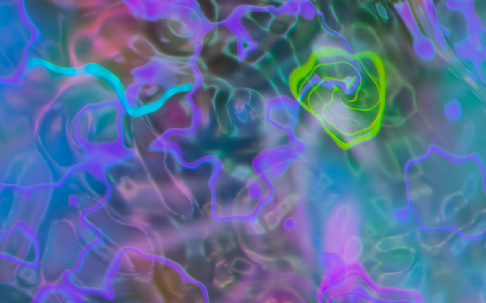

# Acid Rain

Water, dissolving colour, and psychedelic light. A moving camera explores a procedural
underwater world while currents carry ripples and pigment in another direction.

**[Download the latest release](https://github.com/Yamp/acid-rain/releases/latest)** ·
[Desktop guide](desktop/README.md) · [macOS Metal edition](native/README.md)



## Choose an edition

| Edition | Platforms | Rendering |
|---|---|---|
| **Desktop** (`acid-rain-desktop`) | Windows, Linux, macOS | GPU: DirectX 12 / Vulkan / Metal |
| **Terminal** (`acid-rain`) | Windows, Linux, macOS | True-colour Unicode half blocks |
| **Native Metal** (`Acid Rain.app`) | macOS | Swift window, Metal renderer |

Release archives include the desktop and terminal executables, launchers, documentation
and SHA-256 checksums. Choose Windows x64, Linux x64, macOS Apple Silicon or macOS Intel.
The Apple Silicon archive also includes the original native Metal application.

On Windows, extract the archive and open `acid-rain-desktop.exe`.
On Linux, extract it and run `./acid-rain-desktop` in a graphical session.
On macOS, open the included desktop app bundle. These are unsigned community builds;
use your operating system's normal approval flow for an app you trust.
Desktop requires a graphics driver supporting compute shaders and floating-point render
targets. Linux supports both Wayland and X11; install your distribution's Vulkan driver.
The terminal edition needs a terminal with 24-bit colour and Unicode support.

## What it does

- Classic water with gravity-capillary impact waves, or switch to a draining whirlpool
  and shallow river rapids.
- Finite-volume pigment transport, localized vortex wakes and configurable bleaching.
  Desktop and Metal use a conservative 3D cloud; the terminal uses a depth-averaged field.
- Fresnel reflection, dispersed refraction, spectral bottom caustics, bounded secondary
  reflections and Beer attenuation.
- Fractal mineral beds, emissive veins and moving, world-anchored patterns.
- Floating RGB channels, three afterimage time scales, gradual exposure adaptation and
  a normalized spectral diffraction filter.
- Smooth camera travel and rotation, six scenes and an automatic Journey between them.
- Separate simulation and display clocks, bounded GPU resources, and manual or automatic
  render quality. High is the default; Auto adjusts internal resolution to the workload.

Defaults preserve the preferred profile: **Classic / Journey / High / speed 2.4× /
Trip 4 / RGB shift 2 pixels / subjective effects 1**. Rain is 32 impacts per physical
second, diameter 1.5×, bleaching 1×. Airborne drops are hidden; their impacts and clouds
remain active.

## Controls

Press **H** for the full control overlay and current values. Help holds the animation.

| Key | Action |
|---|---|
| Space | Pause / resume |
| `[` / `]`, Left / Right; `s` | Speed down / up; reset |
| Up / Down; `,` / `.` | Rain rate; drop diameter |
| `v` / `b`; Shift+B | Bleaching down / up; reset |
| `-` / `+` | Trip intensity |
| `n` / `m`; Shift+N | Subjective effects down / up; reset |
| `j` / `l`; Shift+J | RGB displacement down / up; reset |
| `e`; `i` | RGB/retinal effects; frame blending |
| `g` / Tab; `t` | Next scene; Journey |
| `d`; `f` | Drain / Classic; Rapids / Classic |
| `c`; `w` | Camera travel; independent current |
| `k`; `0`–`3` | Cycle quality; Auto / High / Balanced / Low |
| `r`; Shift+R | Drop burst; restore rain and diameter |
| `q` / Escape | Quit (Escape first closes help) |

Desktop additionally supports **click / O** to add a drop, **A** to show falling drops,
**X** to clear pigment, **P** for quiet drop-observation lighting, **4** for Native
resolution, and **F11 / Alt+Enter** for fullscreen (also Cmd+F on macOS).
Windowed shortcuts use physical key positions, including with a Russian keyboard layout.

## Build from source

Requires Rust 1.88 or newer. Use a release build for interactive rendering.
The checked-in lockfile covers all three Rust packages.

```sh
# Desktop:
cargo check --locked -p acid-rain-desktop
cargo run --locked --release -p acid-rain-desktop

# Terminal:
cargo check --locked -p acid-rain
cargo run --locked --release -p acid-rain

# Original macOS Metal app (also requires Apple's Swift/macOS SDK):
./native/run.sh
```

Linux build dependencies and backend selection are in the [desktop guide](desktop/README.md).
`./run.sh` remains the terminal launcher and optimizes a local build for your CPU.
Published binaries use portable target defaults.

```sh
# Desktop examples:
cargo run --release -p acid-rain-desktop -- --mode drain --quality auto
cargo run --release -p acid-rain-desktop -- --drop-demo --show-drops
cargo run --release -p acid-rain-desktop -- --lsd 2 --rgb-shift 1.5
cargo run --release -p acid-rain-desktop -- --headless --size 1280x800 \
  --frames 120 --output frame.png --report timings.json

# Terminal examples:
./run.sh --water rapids --scene prism
./run.sh --quality auto --lsd 1.5
./run.sh --help
```

## Models and limits

The water solvers combine a bounded local surface, analytic finite-depth waves and
depth-averaged hydraulic models. Pigment transport conserves mass apart from specified
sources, bleaching and domain exit. Three-dimensional cloud velocity combines the
shared flow with modeled impact vortex rings; it is **not** a fully resolved 3D
Navier–Stokes solver. Splashes, multiple scattering and optical path counts are bounded
approximations. The subjective effects are an artistic layer, not a clinical vision model.

Model notes: [waves](docs/PHYSICS.md), [rapids](docs/RAPIDS.md),
[drain](docs/DRAIN.md), [pigments](docs/DYE.md), [optics](docs/OPTICS.md).
The terminal and GPU editions share simulation code but have different rendering
budgets and representations; they are not pixel-identical.

## Validate

```sh
cargo check --locked --workspace --all-targets
cargo test --locked --workspace
cargo clippy --locked --workspace --all-targets -- -D warnings
cargo fmt --all --check

# Real GPU contracts: conservation, caustics and optical invariants.
ACID_RAIN_GPU_TESTS=1 cargo test --locked -p acid-rain-desktop --tests
# Deterministic offscreen capture and timing report:
cargo run --locked --release -p acid-rain-desktop -- --headless \
  --warmup 30 --frames 120 --output frame.png --report timings.json
# Terminal PTY controls and resize/restore checks (macOS/Linux):
uv run --no-project python scripts/pty_smoke.py
```

CI compiles and tests on Windows, Linux, Apple Silicon and Intel macOS. GPU contract
tests also run with a Linux software Vulkan driver. Software-driver checks establish
rendering correctness, not hardware performance. Headless timing reports identify the
adapter and backend; actual window cadence also depends on the compositor and display.

## License

Apache-2.0. Original project by [Yamp](https://github.com/Yamp).
